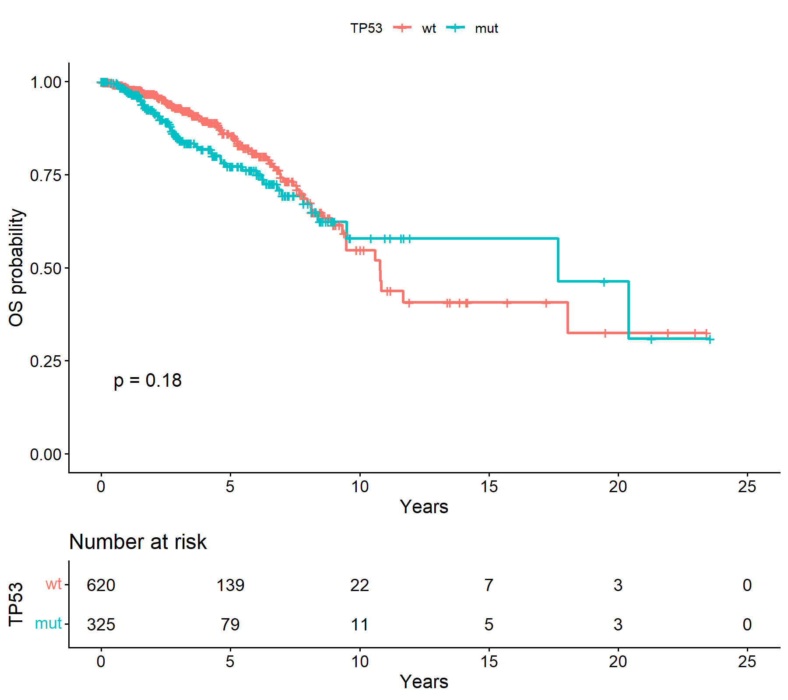

# TP53 Mutation in Breast Cancer: Differential Expression and Survival (TCGA-BRCA)

## Question
How does TP53 mutation status relate to gene expression and prognosis in breast cancer,
and how much of that association is explained by molecular subtype?

## Data
- **Expression:** TCGA-BRCA primary tumors, RNA-seq STAR counts (GDC), downloaded with TCGAbiolinks; protein-coding genes only
- **Mutations:** GDC masked somatic MAF. A patient counts as TP53 `mut` if they have any non-silent TP53 variant, and as `wt` otherwise
- **Subtype:** PAM50 (`paper_BRCA_Subtype_PAM50`)
- **Clinical:** GDC clinical fields (vital status, follow-up, age, AJCC stage)

| Set | Patients | TP53 mut / wt | Deaths |
|---|---|---|---|
| Expression + mutation calls | 965 | 331 / 634 | – |
| Differential expression (PAM50 available) | 954 | – | – |
| Survival (OS, time > 0) | 945 | 325 / 620 | 130 |
| Multivariable Cox (age, stage, subtype complete) | 842 | – | 89 |

TP53 mutation is concentrated in Basal tumors: 149 of 167 Basal tumors are TP53-mutant, compared with 52 of 486 LumA tumors.

## Pipeline
All scripts read `scripts/00_config.r`, which sets the debug/full mode, seed, cores, survival endpoint and output paths.

| Script | Step | Main outputs |
|---|---|---|
| `00_config.r` | Shared settings and helpers (`tagged()`, `subsample()`) | – |
| `01_setup.r` | Install CRAN/Bioconductor packages; download and prepare RNA-seq | `data/brca_se.rds` |
| `02_merge.r` | Download MAF, call TP53 status, build patient metadata | `data/meta.rds` |
| `03_build_dds.r` | Protein-coding genes; filter (≥10 counts in ≥50 samples); build DESeqDataSet | `data/dds.rds` |
| `04_pca.r` | VST + PCA, colored by TP53 and by subtype | `PCA_*.png` |
| `05_deseq.r` | DESeq2: Model 1 `~ TP53`; Model 2 `~ subtype + TP53 + subtype:TP53` | `res1_*.csv`, `res2_*.csv` |
| `06_compare.r` | Compare the two models; volcano plot; counts for MDM2 / CDKN1A / MKI67 | `lfc_compare_*.png`, `volcano_*.png` |
| `07_enrichment.r` | fgsea on Hallmark sets (ranked by Wald stat); GO BP on up/down genes | `gsea_hallmark_*.csv/png`, `go_*.csv/png` |
| `08_survival_data.r` | Build survival table (endpoint, time in years, stage collapsed to I–IV) | `data/surv.rds` |
| `09_survival.r` | Kaplan–Meier; univariable, multivariable and subtype-stratified Cox; PH check | `km_tp53_*.png`, `cox_*.csv`, `schoenfeld_*.png` |
| `10_gene_survival.r` | Cox model per top-20 DE gene (VST z-score), adjusted for TP53, age and stage, stratified by subtype | `gene_cox_*.csv` |

Results go to `results/summaries/` (tables) and `results/figures/` (plots). File names end in `_DEBUG` or `_FULL`, depending on the mode. Survival outputs from 08–09 depend only on the endpoint (`_OS`), not on the mode.

## Key decisions and rationale
1. **Adjusting for subtype.** TP53 mutation is strongly confounded with subtype: most Basal tumors are TP53-mutant and most LumA tumors are wild-type. Model 1 (`~ TP53`) mixes the TP53 effect with the subtype difference. Model 2 includes subtype and the subtype × TP53 interaction, so the TP53 contrast is estimated within subtype.
2. **Patients without mutation calls are excluded, not treated as wild-type.** A patient missing from the MAF has no evidence of being wild-type, so only patients who appear in the MAF are kept.
3. **One sample per patient.** RNA-seq is restricted to primary tumors and deduplicated by patient barcode, so each patient enters the models once.
4. **Effect-size threshold** (|log2FC| > 1) in addition to FDR < 0.05. With ~950 samples, DESeq2 calls very small fold changes significant, and parametric DE tests are known to inflate false positives at large sample sizes (Li et al., 2022).
5. **OS as the current endpoint.** OS comes straight from the GDC clinical data. TCGA-CDR (Liu et al., 2018) recommends PFI for BRCA because follow-up is short and deaths are few. Setting `ENDPOINT <- "PFI"` (which needs `data/TCGA-CDR-SupplementalTableS1.xlsx`) switches to PFI.
6. **Stratified Cox as a sensitivity analysis.** The Schoenfeld test shows no violation of proportional hazards (global p = 0.41; subtype p = 0.47). A model stratified by subtype, which lets each subtype have its own baseline hazard, is reported alongside the adjusted model.

## Results
> Differential expression and pathway results below need a full run (`DEBUG <- FALSE`). Survival results (08–09) do not depend on `DEBUG` and are final for OS.

### Differential expression


- Model 1 (`~ TP53`): __ significant genes
- Model 2 (`~ subtype + TP53 + subtype:TP53`): __ significant genes
- Overlap: __

### Pathways
- Hallmark GSEA (Model 2): __

### Survival (OS)


| Model | n / deaths | HR (TP53 mut vs wt) | 95% CI | p |
|---|---|---|---|---|
| Univariable | 842 / 89 | 1.21 | 0.79–1.85 | 0.39 |
| + age, stage, subtype | 842 / 89 | 1.09 | 0.63–1.90 | 0.76 |
| + age, stage, strata(subtype) | 842 / 89 | 1.10 | 0.63–1.94 | 0.74 |

All three models use the same complete-case set, so the HRs can be compared directly. No model shows a significant association between TP53 mutation and OS, and the point estimate moves toward 1 after adjusting for subtype.

## Limitations
- Short follow-up (median 2.3 years) and few deaths in TCGA-BRCA give low power for OS
- About 11% of survival patients drop out of the multivariable model because stage is missing, Stage 0 or Stage X
- Large-sample false positives in DESeq2 (Li et al., 2022)
- Observational data: TP53 status is not randomized, and adjustment covers only measured confounders
- The gene-level Cox analysis (10) tests DE-selected genes, so it is exploratory

## Reproduce
Run everything from the project root (all paths are relative to it).

```r
# Once: install packages, download data, build metadata
Rscript scripts/01_setup.r
Rscript scripts/02_merge.r

# Analysis (03–10)
Rscript run_all.R
```

`DEBUG <- TRUE` in `scripts/00_config.r` makes 04–07 and 10 run on a random 200-sample subset (seed 76), for quick testing. Set `DEBUG <- FALSE` for full results.

Raw downloads (`GDCdata/`, `data/`) and `*.rds` files are git-ignored.

## References
- Liu J, et al. An integrated TCGA pan-cancer clinical data resource to drive high-quality survival outcome analytics. *Cell* 2018.
- Li Y, et al. Exaggerated false positives by popular differential expression methods when analyzing human population samples. *Genome Biology* 2022.
